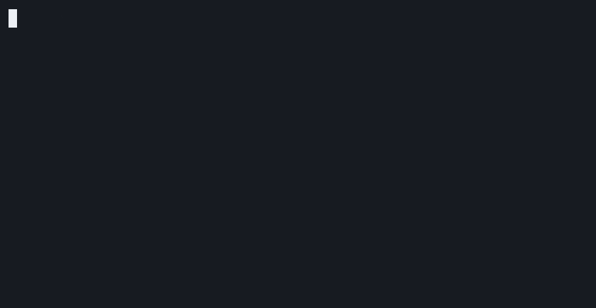

# Tersalang

[](https://pypi.org/project/tersalang/)
[](https://pypi.org/project/tersalang/)
[](https://github.com/kevindm-design/tersalang/actions/workflows/ci.yml)
[](https://github.com/kevindm-design/tersalang/blob/main/LICENSE)

**A small, strict, word-based language for language models to write and reinforcement-learning harnesses to score.**

```bash
pip install tersalang
```

That installs the `tersa` command. You need CPython 3.12 or newer (CI runs 3.12, 3.13, and 3.14). The interpreter has no runtime dependencies.

The language version is **0.1-draft** and the tool version is **0.1.0**. Both can still change in incompatible ways. This repository holds the reference interpreter and an exported copy of the language specification.

## Quickstart

Save this as `area.tersa`. The same program is [`examples/area.tersa`](examples/area.tersa).

```tersa
module area

import std.console exposing print

public record Rect
  width: Int
  height: Int
  invariant width >= 0 and height >= 0
end

public function area(r: Rect) returns Int
  ensures result >= 0
do
  return r.width * r.height
end

test "a 3 by 4 rectangle has area 12"
do
  expect area(Rect(width = 3, height = 4)) == 12
end

public function main() returns Unit
  uses Console
do
  print(show(area(Rect(width = 3, height = 4))))
end
```

Check the file, run its test, then run `main`. `Console` is an effect, so the host has to grant it:

```bash
tersa check area.tersa
tersa test area.tersa
tersa run area.tersa --allow Console
```

`tersa check` prints nothing and exits 0 when the file is clean. `tersa test` ends with `1 test passed, 0 doc examples passed`. `tersa run` prints `12`.

Running without the grant stops before `main`, with a stable code and a fix:

```console
$ tersa run area.tersa
error[E4010]: main uses Console, but Console was not granted
  --> area.tersa:23:8
  = fix: run with --allow Console
```



## Why Tersalang

- **Blocks are words.** A block opens with `do` and closes with `end`. `tersa fmt` rewrites every file into the one canonical layout, and it has no configuration.
- **Effects are declared.** A function lists what it needs with `uses`. The host grants each effect with `--allow`. A `main` that uses an effect you did not grant is refused before it starts (`E4010`).
- **Contracts are checked at run time.** `requires`, `ensures`, and `invariant` run with the program. Building the `Rect` above with a negative side traps `T6103` (`invariant failed`).
- **Diagnostics are data.** Every diagnostic has a stable code and a JSON form (`tersa.diagnostic/0.1`). `check`, `run`, `test`, and `sandbox` accept `--json`.
- **Programs can be scored.** `tersa harness` runs an attempt against hidden tests under fuel and memory limits and prints one episode (`tersa.result/0.9`). `tersa grammar --format gbnf` prints a grammar that stock llama.cpp accepts, so a model can be limited to programs that parse.

## From a git checkout

Contributors use [uv](https://docs.astral.sh/uv/):

```bash
git clone https://github.com/kevindm-design/tersalang.git
cd tersalang
uv sync
uv run tersa version
```

`pip install -e .` also puts `tersa` on your `PATH`. Commands below are written as `tersa`. From this checkout, that is `uv run tersa`.

## Commands

| Command | What it does |
| --- | --- |
| `tersa check FILE` | Parse and type-check |
| `tersa run FILE` | Run `main` |
| `tersa test FILE` | Run `test` blocks and doc examples |
| `tersa sandbox FILE` | Run `main` in RL mode, with finite default limits and only the grants you pass |
| `tersa fmt [PATH ...]` | Rewrite files into the canonical layout |
| `tersa grammar` | Print the grammar as EBNF, Lark, or GBNF |
| `tersa harness run TASK --attempt FILE` | Score one attempt against a task |
| `tersa version` | Print the tool, language, schema, and Unicode versions |

`tersa fmt --check` only reports. It prints a diff and exits 1 when a file would change:

```console
$ tersa fmt --check messy.tersa
would reformat messy.tersa
--- messy.tersa
+++ messy.tersa
@@ -2,5 +2,5 @@

 public function area(r: Int) returns Int
 do
-      return r*r
+  return r * r
 end
```

With `--json`, stdout ends with one line holding the diagnostics. This file returns `Text` where `main` says `Int`:

```console
$ tersa check --json bad.tersa
[{"schema": "tersa.diagnostic/0.1", "code": "E3033", "severity": "error", "category": "type", "message": "expected Int, found Text", "file": "bad.tersa", "span": {"start": {"line": 5, "column": 10}, "end": {"line": 5, "column": 14}}, "related": [], "blame": null, "values": null, "fix": null, "docs_url": "https://github.com/kevindm-design/tersalang/blob/main/docs/diagnostics.md#e3033"}]
```

`bad.tersa` is:

```tersa
module bad

public function main() returns Int
do
  return "no"
end
```

Each code has a wrong example and a fixed example in [docs/diagnostics.md](docs/diagnostics.md). Flags, execution modes, limits, and exit codes are in [docs/cli.md](docs/cli.md).

## Harness

`tersa harness` scores one program against a task. That is the loop an RL trainer runs. A task is a directory:

```
examples/tasks/add_one/
  task.toml              limits, effect grants, reward settings
  prompt.md              what the agent is asked to do
  interface.tersa        the functions the attempt must define, with contracts
  visible_tests.tersa    tests the agent may see
  hidden/tests.tersa     tests that score the attempt
  reference/solution.tersa
```

```bash
tersa harness run examples/tasks/add_one --attempt my_attempt.tersa
tersa harness run examples/tasks/add_one --attempt my_attempt.tersa --agent-view
tersa harness validate examples/tasks/add_one
```

`harness run` prints one `tersa.result/0.9` episode as JSON. The harness:

- Checks that the attempt defines the functions `interface.tersa` requires, with the same signatures.
- Merges the attempt with the hidden tests in a private namespace, so the attempt cannot reach or redefine hidden code.
- Runs each hidden test in a fresh interpreter under fixed fuel and memory limits, in a child process with OS isolation where the host supports it.
- Scores the episode as `reward = (1 - w) * C + w * C * E`. `C` is the fraction of hidden tests passed (with the default `check_credit` of 0), `E` compares fuel used with the reference solution, and `w` defaults to 0.1.

`--agent-view` prints the copy an agent may see. That copy withholds hidden-test detail and rounds the resource counts. `harness validate` checks a task before training: the reference must pass, and sampled mutants of it must not.

The full rules are in [docs/harness.md](docs/harness.md): the reward, isolation backends, scored traps versus discarded episodes, and the reward-hacking defenses.

## Grammars

`tersa grammar` prints the grammar as EBNF (the default), Lark, or GBNF. The GBNF export works with stock llama.cpp:

```bash
tersa grammar --format gbnf                      # every layout the parser accepts
tersa grammar --format gbnf --profile decoding   # the formatter's whitespace, for generation
```

See [docs/gbnf.md](docs/gbnf.md).

## Documentation

| Document | Contents |
| --- | --- |
| [spec/](spec/) | The Design Doc and the Language Reference, plus the grammars and catalogs |
| [docs/cli.md](docs/cli.md) | Every `tersa` command, flag, execution mode, and exit code |
| [docs/harness.md](docs/harness.md) | Task layout, reward formula, agent view, isolation, and reward-hacking defenses |
| [docs/gbnf.md](docs/gbnf.md) | The GBNF export, its two profiles, and how it is checked against llama.cpp |
| [docs/diagnostics.md](docs/diagnostics.md) | Every diagnostic code with examples (generated from `spec/diagnostics.yaml`) |
| [docs/spec-notes.md](docs/spec-notes.md) | Where this interpreter settles a point the specs leave open |
| [CHANGELOG.md](CHANGELOG.md) | What changed in each release |

## Repository layout

| Path | Contents |
| --- | --- |
| `src/tersalang/` | The interpreter. The package docstring in `__init__.py` lists each module |
| `spec/` | Specification exports, `tersa.ebnf`, `tersa.lark` (the grammar oracle and source of `tersa.gbnf`), the diagnostic, fuel, and limit catalogs, and JSON schemas |
| `conformance/` | `.tersa` programs whose header says what each must produce, such as `# expect: check-error E3033` |
| `examples/` | `hello.tersa`, the quickstart `area.tersa`, and the `add_one` harness task |
| `tests/` | Unit, conformance, property, and fuzz tests |
| `scripts/` | CI checks: formatting, GBNF drift, llama.cpp agreement, determinism bytes, and the generated diagnostics page |
| `teps/` | The template for Tersalang Enhancement Proposals |

## What this version runs

The interpreter lexes, parses, type-checks, and evaluates one file plus the built-in standard library: `List`, `Map`, `Set`, `Text`, `Bytes`, `Option`, `Result`, math, console, files, clock, random, and JSON. `Int` is arbitrary precision with a 65,536-bit cap, and `Int64` traps on overflow. Not yet included: multi-file packages, the language server, `Net`, and container isolation beyond bubblewrap.

The language was formerly called AIOWL.

## Contributing

Small, tested changes are welcome. See [CONTRIBUTING.md](CONTRIBUTING.md). Report bugs and request features in the [issue tracker](https://github.com/kevindm-design/tersalang/issues). Language changes go through a TEP. Copy [`teps/0000-template.md`](teps/0000-template.md). Every commit needs a `Signed-off-by` trailer.

The code is Apache-2.0 ([LICENSE](LICENSE)). The specification and the documents in `docs/` are CC BY 4.0 ([LICENSE-docs](LICENSE-docs), [NOTICE](NOTICE)).
